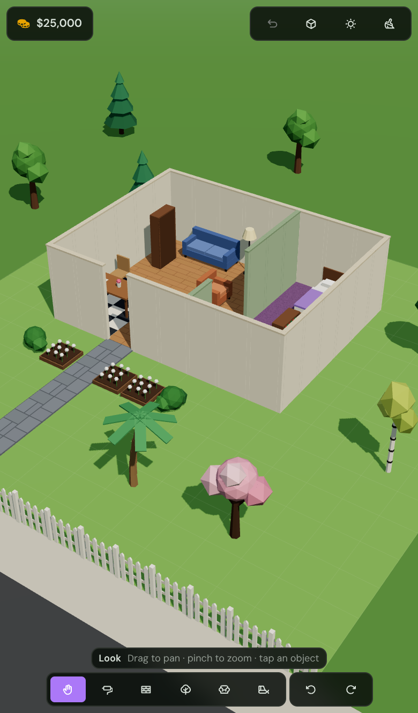
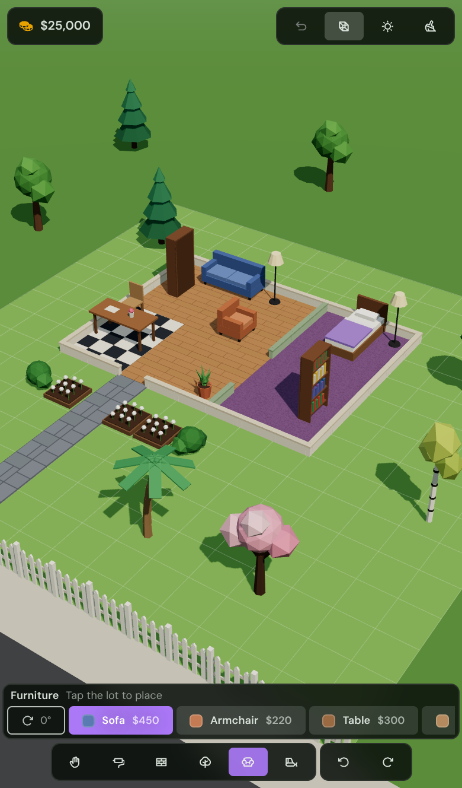
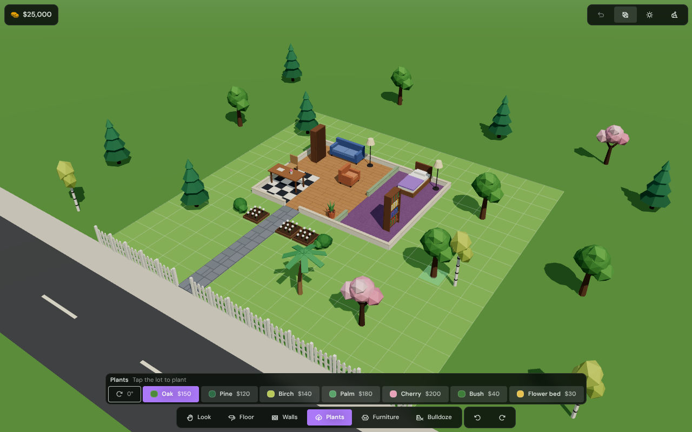

# plot

Mobile-first 3D lot builder. A proof of concept for a life-sim style
build mode: zoom around your lot, paint floors, draw walls, plant trees,
and furnish rooms.

```sh
pnpm dev:plot     # from the repo root, http://localhost:5177
pnpm build:plot
```

The dev server listens on the LAN (`host: true`) so you can open it on
a phone.

## Controls

| Gesture | Look / Plants / Furniture / Bulldoze | Floor / Walls |
| --- | --- | --- |
| One finger drag | pan | draw |
| Tap | select / place / remove | paint one tile |
| Pinch | zoom | zoom |
| Two finger drag | orbit | pan |
| ⟲ ⟳ buttons | turn camera 90° | turn camera 90° |

Desktop: left drag pans (or draws), right drag orbits, wheel zooms.

## Stack

- **react-three-fiber + three** for the scene. Every model is built
  from low-poly primitives in `src/scene/models`; floor and brick
  textures are drawn on canvases at runtime (`src/scene/textures.ts`).
  No asset files.
- **@tasteee/zest** for the HUD. Zest sizes in `rem`, so `app.css`
  shrinks the root font size on phones to scale every control down.
- **datass** for state (`src/game/store.ts`). The world autosaves to
  `localStorage` and keeps an undo history.

## Layout

```
src/
  game/    rules: catalog, grid math, footprints, actions, stores
  scene/   3D: camera rig, ground, floors, walls, objects, previews
  hud/     zest overlay: top bar, tool bar, catalog tray, selection
```

## Screens

| Phone | Phone, build mode | Desktop |
| --- | --- | --- |
|  |  |  |
