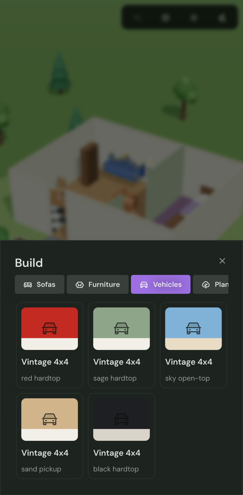
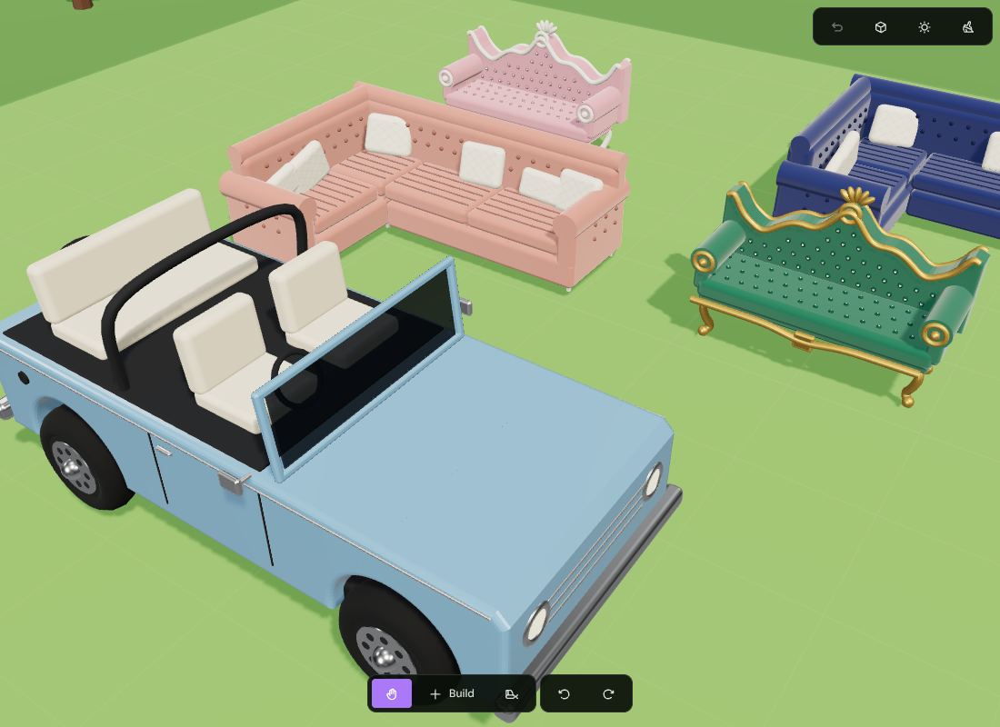

# plot

Mobile-first 3D lot builder. A proof of concept for a life-sim style
build mode: zoom around your lot, paint floors, draw walls, plant trees,
furnish rooms and park cars. No money, just building: tap **Build**,
pick a category and an item, then tap the lot to place it.

**Live**: `<GitHub Pages URL>/plot/`. Every merge to `main` deploys it.
The root `pnpm build` builds the main site, then builds this app into
`apps/blog/dist/plot` with the site's base path (`VITE_BASE_PATH`), so
the existing Pages workflow (and the Netlify/Vercel previews) ship it
at `/plot/`.

Local dev, if you ever want it:

```sh
pnpm dev:plot     # from the repo root, http://localhost:5177
```

The dev server listens on the LAN (`host: true`) so you can open it on
a phone.

## Controls

| Gesture | Look / Place / Bulldoze | Floor / Walls |
| --- | --- | --- |
| One finger drag | pan | draw |
| Tap | select / place / remove | paint one tile |
| Pinch | zoom | zoom |
| Two finger drag | orbit | pan |
| ⟲ ⟳ buttons | turn camera 90° | turn camera 90° |

Desktop: left drag pans (or draws), right drag orbits, wheel zooms.

## Stack

- **react-three-fiber + three** for the scene. Every model is built in
  code in `src/scene/models`, no asset files:
  - `trees.tsx`, `furniture.tsx`: low-poly primitives.
  - `sofas.tsx`: medium detail. A rococo throne sofa (extruded carved
    back, gold trim tubes, tufting, scroll arms, cabriole legs) and an
    L tufted sectional (channel-stitched cushions, quilted pillows).
  - `vehicles.tsx`: a vintage 4x4 (extruded body with wheel arches,
    chrome, headlights that glow at night) as hardtop, open-top and
    pickup.
  - `materials.ts`, `geometryKit.ts`: shared, cached materials (velvet
    sheen, gold, chrome, clear-coat paint) and geometry, so many placed
    copies stay cheap.
- **@tasteee/zest** for the HUD: the build menu is a bottom `z-sheet`
  with `z-card` items.
- **datass** for state (`src/game/store.ts`). The world autosaves to
  `localStorage` and keeps an undo history.

## Layout

```
src/
  game/    rules: catalog, grid math, footprints, actions, stores
  scene/   3D: camera rig, ground, floors, walls, objects, previews
  hud/     zest overlay: top bar, tool bar, catalog tray, selection
```

## Screens

| Phone | Phone, build mode | Desktop |
| --- | --- | --- |
|  |  |  |
